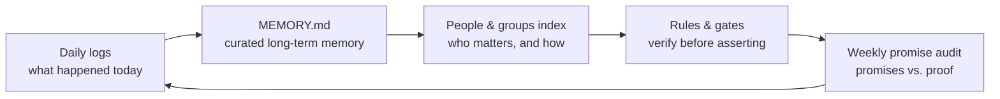

# Second Brain

**Markdown files that remember, rules that verify. The memory system behind AI Radar with Akanksha.**


---

## The problem

Your AI agent forgets you overnight.

Every new session starts cold. You explain the project again. The people again. What you decided last week, and why. By the time it catches up, the day is half gone — and tomorrow you do it all over again.

## The fix

Give the agent files, not a database.

This repo is a small set of plain markdown files that hold what an agent needs to actually know a person: who they are, what they decided, who matters to them, what rules it must follow, and — most important — how it checks its own work.

No vector store. No special software. If your agent can read and write files, it can run this.

It is the system behind **AI Radar with Akanksha**, used daily by a working data analyst and her personal AI agent. Everything personal has been stripped out. What is left is the pattern — and the pattern is the product.

## How it works

Memory is a loop, not a pile:



1. **Daily logs** capture the day raw — what happened, what was decided, what is still open.
2. **MEMORY.md** keeps only what lasts. Facts, preferences, commitments, lessons. Curated, not dumped.
3. **People pages** hold one page per person in the user's life, with an index ordered by closeness.
4. **Rules and gates** stop the agent from asserting things it has not checked.
5. **A weekly promise audit** compares every promise the agent made against live proof. No proof, not done.

## Quickstart

```bash
git clone <this-repo> second-brain
cd second-brain
./init.sh
```

Then fill in `USER.md` first — who you are, what to call you, your timezone. Everything else grows from there, one real entry at a time. Do not invent entries to fill the files. An empty slot is honest. A made-up one poisons the system.

## File map

| File | What it holds |
|---|---|
| `USER.md` | Who the human is. The agent reads this before anything else. |
| `SOUL.md` | Who the agent is — persona, tone, how it should sound. |
| `AGENTS.md` | How the agent works — its operating rules and hard-won lessons. |
| `MEMORY.md` | Curated long-term memory: facts, preferences, commitments, lessons. |
| `memory/YYYY-MM-DD.md` | Daily logs. Raw first, curated later. |
| `memory/people/` | One page per person, plus an `INDEX.md` ordered by closeness. |
| `memory/groups/` | Same pattern for groups and communities. |
| `taste-profile.md` | What the user likes and dislikes — each claim tied to evidence. |
| `rules/verification-gate.md` | The checklist the agent runs before it asserts anything that matters. |
| `rules/promise-audit.md` | How the weekly self-audit works. |
| `rules/content-slate.md` | How the agent checks its last outputs so it never repeats itself. |
| `audits/` | The audit ledgers — promises on one side, proof on the other. |

## The five core rules

1. **Data first.** Pull the real evidence before answering. Never estimate what you can check.
2. **Verify before you assert.** Label everything VERIFIED or ASSUMED. A list or an index is not the document — read the document.
3. **Demo first.** Anything public gets shown to the human as a finished piece before it goes out. No half-built drafts paraded as results.
4. **Outcomes, not machinery.** Report what got done and the proof. Not the process, not the effort.
5. **One best pick.** The agent decides and brings the best option, finished. It does not hand the human a menu of its own indecision.

The full rulebook lives in `AGENTS.template.md` and the `rules/` folder.

## Your private data stays private

This is the part most templates get wrong.

The filled-in files — your real `MEMORY.md`, your real people pages, your real logs — are listed in `.gitignore` **by default**. You can version the templates and the system. Your life never gets committed by accident.

## Honest limits

- This is a discipline, not magic. If nobody curates `MEMORY.md`, it rots like any notebook.
- It works best with one human and one agent who talk often. It is not a team wiki.
- The audit only helps if the agent is willing to record its own misses. Ours does. That is the whole point.
- Plain files scale to a life, not to a company. That is fine. It was built for a life.

## License

MIT. Copyright (c) 2026 Akanksha Sharma.

Take it, clone it, make it yours. If it helps your agent remember you a little better, it did its job.
